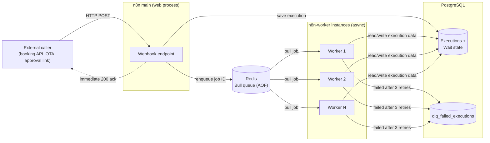

# n8n Queue Mode Architecture

An incoming webhook event arrives on the main n8n web node. The node saves the execution in PostgreSQL, pushes the job ID to the Redis queue, and acknowledges the caller right away. Worker instances pull jobs from Redis and process them asynchronously. Payloads that still fail after 3 retries go to the DLQ table in PostgreSQL.

